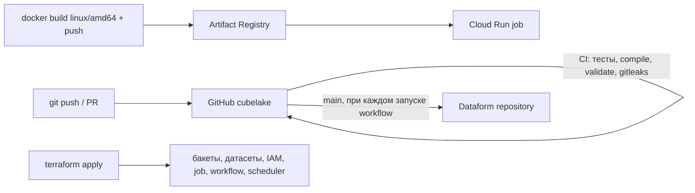
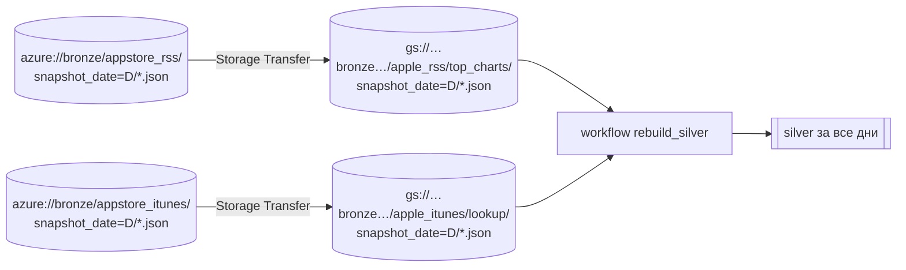

# Data flow

Здесь показано, как данные проходят через проект: что запускается, кем и когда, что откуда читается и
куда пишется. Подробности о форматах — в [data.md](data.md), о компонентах — в [architecture.md](architecture.md).

## Общая картина

Сплошные стрелки показывают запись или чтение во время запуска. Пунктир — BigLake-таблица смотрит на
файлы, данные при этом не копируются.

## Ежедневный запуск, по шагам

| # | Шаг workflow | Кто выполняет (identity) | Читает | Пишет | Если ошибка |
| --- | --- | --- | --- | --- | --- |
| 0 | `init`, `date_override` | Workflows (`sa-workflows`) | аргумент `snapshot_date` или текущая дата UTC | — | — |
| 1 | `apple_rss_bronze` | Cloud Run job `cubelake-ingest apple-rss --date D` (`sa-ingest`) | 350 URL Apple RSS | `gs://…bronze…/apple_rss/top_charts/snapshot_date=D/<country>_<feed>.json` | job падает, только если не скачалось ничего; частичная загрузка видна в логе как `Wrote X/350` |
| 2 | `apple_rss_silver` | Dataform (`sa-dataform`): компиляция `main` с `vars`, запуск тега `apple_rss` | `bronze_apple_rss.top_charts` с фильтром `snapshot_date = D` | MERGE в `silver_apple_rss.top_apps`, проверки в `dataform_assertions` | workflow падает (ошибка SQL или проверки) |
| 3 | `apple_itunes_bronze` | `cubelake-ingest apple-itunes --date D` (`sa-ingest`) | `silver_apple_rss.top_apps` за D → iTunes Lookup (≤100 id на запрос) | `gs://…bronze…/apple_itunes/lookup/snapshot_date=D/<country>_<feed>.json` | падает, если в silver нет приложений за D |
| 4 | `apple_itunes_silver` | Dataform, тег `apple_itunes` | `bronze_apple_itunes.lookup` за D | MERGE в `silver_apple_itunes.app_details` + проверки | workflow падает |

- Шаги идут строго последовательно: шаг 3 зависит от результата шага 2.
- Файлы Iceberg в silver-бакете физически пишет сервисный аккаунт BigLake connection `lake`, а не
  `sa-dataform`. Dataform только отправляет SQL.
- Повторный запуск того же дня безопасен: bronze перезаписывает файлы дня, silver делает MERGE по ключу.

## Способы запуска

| Как | Команда | Что произойдёт |
| --- | --- | --- |
| Автоматически | Cloud Scheduler, `17 6 * * *` UTC | шаги 0–4 за сегодня |
| Вручную за сегодня | `gcloud workflows run cubelake-daily --location europe-central2` | то же самое |
| Вручную за день D | `… --data='{"snapshot_date":"2026-10-11"}'` | шаги 0–4 за D (Apple отдаёт только текущие чарты, поэтому для прошлых дат в bronze окажутся сегодняшние данные — используйте только для перезапуска сегодняшнего или вчерашнего дня) |
| Пересобрать silver целиком | `… --data='{"rebuild_silver": true}'` | без ingest; Dataform читает **все** дни bronze и делает MERGE в silver (после переноса из Azure или после правки SQL) |
| Только один ingest | `gcloud run jobs execute cubelake-ingest --region europe-central2 --args=apple-rss,--date,D --wait` | только шаг 1 (или 3) |
| Локально | `just ingest apple-rss D /tmp/lake` | шаг 1 в локальную папку |

## Где что хранится (кратко)

| Данные | Место | Формат | Срок хранения |
| --- | --- | --- | --- |
| Сырые ответы API | `gs://cbl-<env>-bronze-<rand>/<source>/<dataset>/snapshot_date=D/` | NDJSON, одна строка на файл | всегда (Nearline после 90 дней; старые версии файлов — 30 дней) |
| Bronze в SQL | `bronze_<source>.<dataset>` | BigLake external table (только указатель на файлы) | — |
| Нормализованные таблицы | `silver_<source>.<table>` | Iceberg managed table | всегда |
| Файлы Iceberg | `gs://cbl-<env>-silver-<rand>/iceberg/<dataset>/<table>/` | Parquet + метаданные Iceberg | управляет BigQuery |
| Результаты проверок | `dataform_assertions.*` | views | — |
| Код SQLX | GitHub `main` → Dataform repository `cubelake` | git | — |
| Образ ingest | Artifact Registry `cubelake/cubelake-ingest:<sha>` | Docker | последние 20 версий |
| Состояние Terraform | `gs://<project>-tfstate/cubelake/` | tfstate | версии бакета |
| GitHub-токен для Dataform | Secret Manager `dataform-github-token` | секрет | — |

## Как код попадает в облако

| Что меняется | Когда начинает работать |
| --- | --- |
| SQLX в `definitions/` | после merge в `main`, с ближайшего запуска (Dataform компилирует `main` каждый раз) |
| Python в `src/` | после сборки и push образа и `terraform apply -var ingest_image_tag=<sha>` |
| `workflows/`, `infra/terraform/` | после `terraform apply` |

Пока это делается вручную. Позже GitHub Actions будет делать это через Workload Identity Federation.

## Перенос старых данных из Azure (однократно)

- Скрипт: [`scripts/migrate_azure_bronze.sh`](../scripts/migrate_azure_bronze.sh). Перед запуском
  выполните `--dry-run`, чтобы увидеть сопоставление путей.
- Копирование идёт на стороне Google (Storage Transfer Service), данные не проходят через ваш компьютер.
- Файлы копируются как есть: формат записи в Azure тот же. Отличается только поле `_source`
  (`ingestion-apple-rss`), silver его не использует.
- Уже существующие в GCS файлы **не перезаписываются** (`--overwrite-when=never`), поэтому дни, собранные
  новым пайплайном, остаются как есть. Скрипт можно запускать повторно.
- Silver и gold из Azure **не переносятся**: silver пересобирается из bronze, а gold пока нет.
