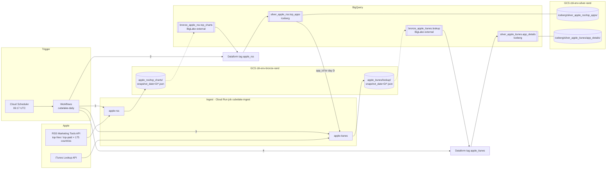
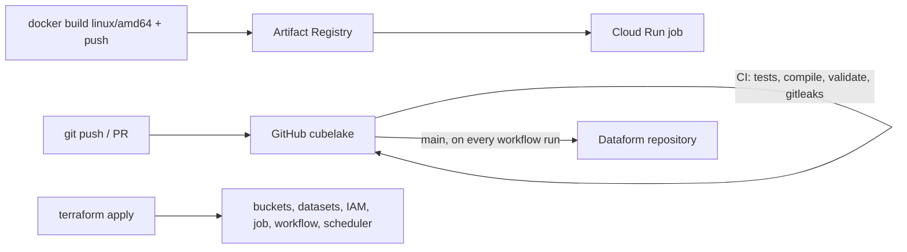
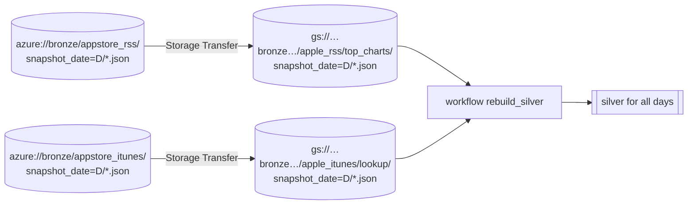

# Data flow

This page shows how data moves through the project: what runs, as whom and when, what is read from where and
written to where. Format details are in [data.md](data.md), components in [architecture.md](architecture.md).

## Big picture

Solid arrows are writes or reads during a run. Dashed means a BigLake table points at the files; no data is
copied.

## Daily run, step by step

| # | Workflow step | Runs as (identity) | Reads | Writes | On error |
| --- | --- | --- | --- | --- | --- |
| 0 | `init`, `date_override` | Workflows (`sa-workflows`) | `snapshot_date` argument or current UTC date | — | — |
| 1 | `apple_rss_bronze` | Cloud Run job `cubelake-ingest apple-rss --date D` (`sa-ingest`) | 350 Apple RSS URLs | `gs://…bronze…/apple_rss/top_charts/snapshot_date=D/<country>_<feed>.json` | the job fails only if nothing was downloaded; a partial load shows in the log as `Wrote X/350` |
| 2 | `apple_rss_silver` | Dataform (`sa-dataform`): compile `main` with `vars`, run tag `apple_rss` | `bronze_apple_rss.top_charts` filtered by `snapshot_date = D` | MERGE into `silver_apple_rss.top_apps`, checks in `dataform_assertions` | workflow fails (SQL or assertion error) |
| 3 | `apple_itunes_bronze` | `cubelake-ingest apple-itunes --date D` (`sa-ingest`) | `silver_apple_rss.top_apps` for D → iTunes Lookup (≤100 ids per request) | `gs://…bronze…/apple_itunes/lookup/snapshot_date=D/<country>_<feed>.json` | fails if silver has no apps for D |
| 4 | `apple_itunes_silver` | Dataform, tag `apple_itunes` | `bronze_apple_itunes.lookup` for D | MERGE into `silver_apple_itunes.app_details` + checks | workflow fails |

- Steps run strictly in sequence: step 3 depends on the result of step 2.
- Iceberg files in the silver bucket are physically written by the service account of BigLake connection
  `lake`, not by `sa-dataform`. Dataform only submits SQL.
- Re-running the same day is safe: bronze overwrites that day's files, silver MERGEs by key.

## Run modes

| How | Command | What happens |
| --- | --- | --- |
| Automatic | Cloud Scheduler, `17 6 * * *` UTC | steps 0–4 for today |
| Manually for today | `gcloud workflows run cubelake-daily --location europe-central2` | same as above |
| Manually for day D | `… --data='{"snapshot_date":"2026-10-11"}'` | steps 0–4 for D (Apple only serves current charts, so for past dates bronze will get today's data — use only to re-run today or yesterday) |
| Rebuild all of silver | `… --data='{"rebuild_silver": true}'` | no ingest; Dataform reads **all** bronze days and MERGEs into silver (after the Azure migration or after a SQL change) |
| Single ingest only | `gcloud run jobs execute cubelake-ingest --region europe-central2 --args=apple-rss,--date,D --wait` | step 1 (or 3) only |
| Locally | `just ingest apple-rss D /tmp/lake` | step 1 into a local folder |

## What is stored where (summary)

| Data | Location | Format | Retention |
| --- | --- | --- | --- |
| Raw API responses | `gs://cbl-<env>-bronze-<rand>/<source>/<dataset>/snapshot_date=D/` | NDJSON, one line per file | forever (Nearline after 90 days; old object versions kept 30 days) |
| Bronze in SQL | `bronze_<source>.<dataset>` | BigLake external table (just a pointer to files) | — |
| Normalized tables | `silver_<source>.<table>` | Iceberg managed table | forever |
| Iceberg files | `gs://cbl-<env>-silver-<rand>/iceberg/<dataset>/<table>/` | Parquet + Iceberg metadata | managed by BigQuery |
| Check results | `dataform_assertions.*` | views | — |
| SQLX code | GitHub `main` → Dataform repository `cubelake` | git | — |
| Ingest image | Artifact Registry `cubelake/cubelake-ingest:<sha>` | Docker | last 20 versions |
| Terraform state | `gs://<project>-tfstate/cubelake/` | tfstate | bucket versioning |
| GitHub token for Dataform | Secret Manager `dataform-github-token` | secret | — |

## How code reaches the cloud

| What changes | When it takes effect |
| --- | --- |
| SQLX in `definitions/` | after merge to `main`, from the next run (Dataform compiles `main` every time) |
| Python in `src/` | after building and pushing the image and `terraform apply -var ingest_image_tag=<sha>` |
| `workflows/`, `infra/terraform/` | after `terraform apply` |

For now this is done by hand. Later GitHub Actions will do it via Workload Identity Federation.

## Migrating old data from Azure (one-off)

- Script: [`scripts/migrate_azure_bronze.sh`](../scripts/migrate_azure_bronze.sh). Run it with `--dry-run`
  first to see the path mapping.
- Copying happens on Google's side (Storage Transfer Service); data does not pass through your machine.
- Files are copied as-is: the record format in Azure is the same. Only the `_source` field differs
  (`ingestion-apple-rss`), and silver does not use it.
- Files that already exist in GCS are **not overwritten** (`--overwrite-when=never`), so days collected by
  the new pipeline stay as they are. The script can be re-run.
- Silver and gold from Azure are **not migrated**: silver is rebuilt from bronze, and there is no gold yet.
